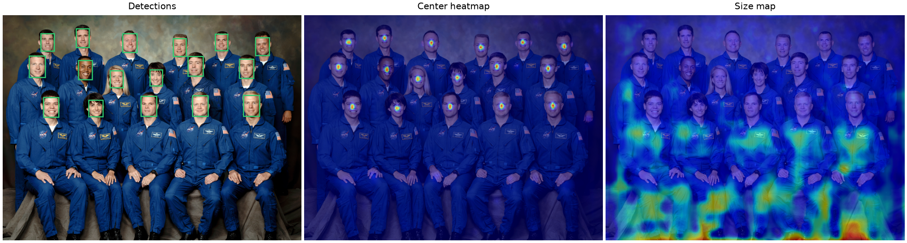

# FaceRadar

Multi-face detection. One
forward pass finds every face in the picture, from a single selfie to a crowd.



*Demo based on [NASA Astronaut Group 18](https://commons.wikimedia.org/wiki/File:NASA_Astronaut_Group_18.jpg)
(Astronaut Class of 2000) by NASA (public domain, via Wikimedia Commons). Modified: model face boxes,
center heatmap and size map overlays.*

## Layout

```
├── faceradar/            # Core library
├── assets/
├── models/               # Saved .pt checkpoints
├── data/                 # train.csv / val.csv + image folders
├── train.py
├── infer_image.py
└── pyproject.toml
```

**Not included:** training images, annotation CSVs, or trained weights. Bring your own dataset in
the format below.

## Install

```bash
python -m venv .venv
source .venv/bin/activate   # Windows: .venv\Scripts\activate
pip install -e .
# or: pip install -r requirements.txt
```

For GPU training, install the PyTorch build that matches your CUDA version first
([pytorch.org](https://pytorch.org/get-started/locally/)), then the command above.

## Training data

```
data/
├── train.csv
├── train/
│   └── ...
├── val.csv
└── val/
    └── ...
```

Custom paths: `--train-csv`, `--train-images`, `--val-csv`, `--val-images`.

### Images

Any photos with any number of faces, at any resolution. Each image is letterboxed (aspect ratio
kept, black padding) to 512×512 for training and inference alike.

### CSV

One row per face:

| Column | Description |
|--------|-------------|
| `filename` | Absolute path, path relative to the image directory, or basename under it |
| `x1`, `y1` | Top-left corner of the face box, in original image pixels |
| `w`, `h` | Box width and height in pixels |

Rows with the same `filename` belong to one image. A row with `w` or `h` equal to `0` lists an
image with no faces. Extra columns are ignored.

```csv
filename,x1,y1,w,h
crowd/001.jpg,449,330,122,149
crowd/001.jpg,361,98,263,339
portrait/002.jpg,78,221,180,220
```

Faces smaller than `--min-face-side` (default 4 px on the 512 input) get no training target.

## Train

```bash
python train.py
python train.py --epochs 40 --output models/face_radar.pt
python train.py --train-csv /path/to/train.csv --train-images /path/to/train \
  --val-csv /path/to/val.csv --val-images /path/to/val
```

Training resumes from `<output>.last.pt`; pass `--fresh` to start over.
Run `python train.py --help` for optional flags.

## Inference

```bash
python infer_image.py --image path/to/photo.jpg
python infer_image.py --image path/to/photo.jpg --model path/to/model.pt --output out.png
python infer_image.py --image path/to/photo.jpg --conf 0.4
python infer_image.py --image path/to/crowd.jpg --no-scores
```

```python
from faceradar import DecodeParams, load_model_from_path, predict_on_image

model = load_model_from_path('models/face_radar.pt')
result = predict_on_image(model, 'photo.jpg', DecodeParams(conf_threshold=0.3))
for face in result['faces']:   # original-image pixels, best score first
  print(face.x1, face.y1, face.width, face.height, face.score)
```

## Checkpoints

| File | From | Used by |
|------|------|---------|
| `face_radar.pt` | `train.py` | `infer_image.py` |
| `*.last.pt` | `train.py` | Resume |
